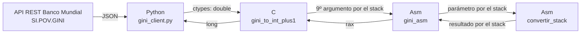
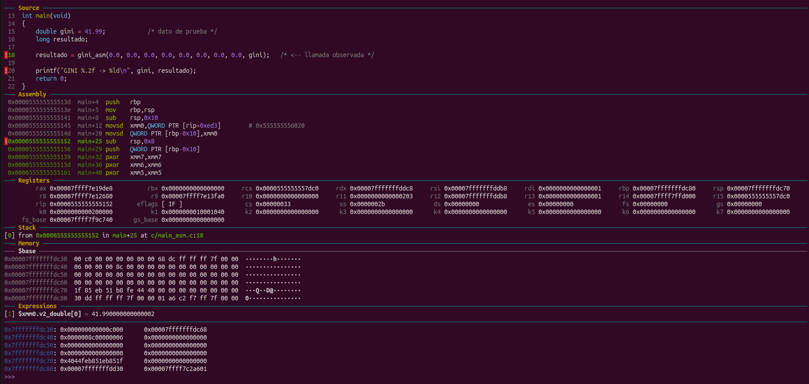
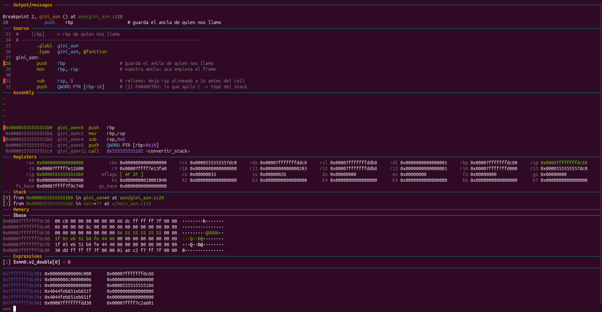
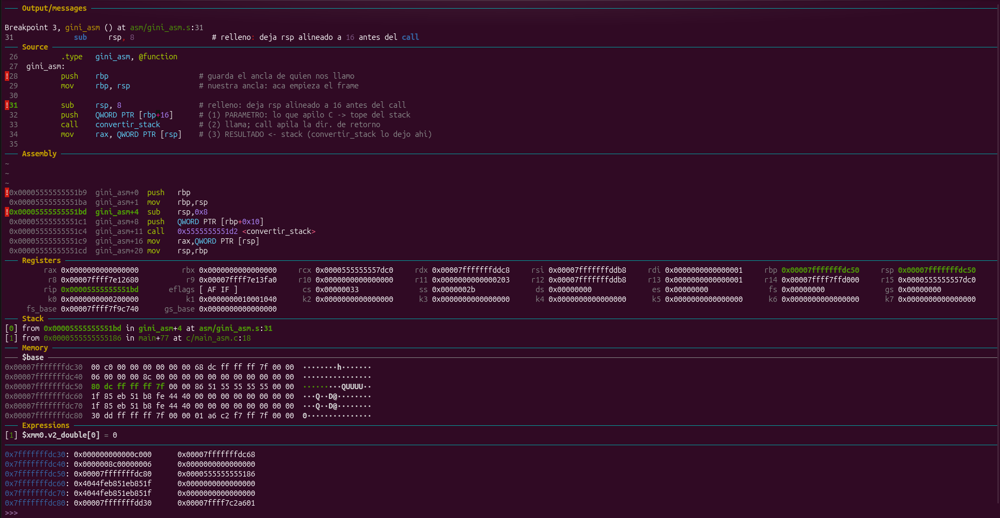
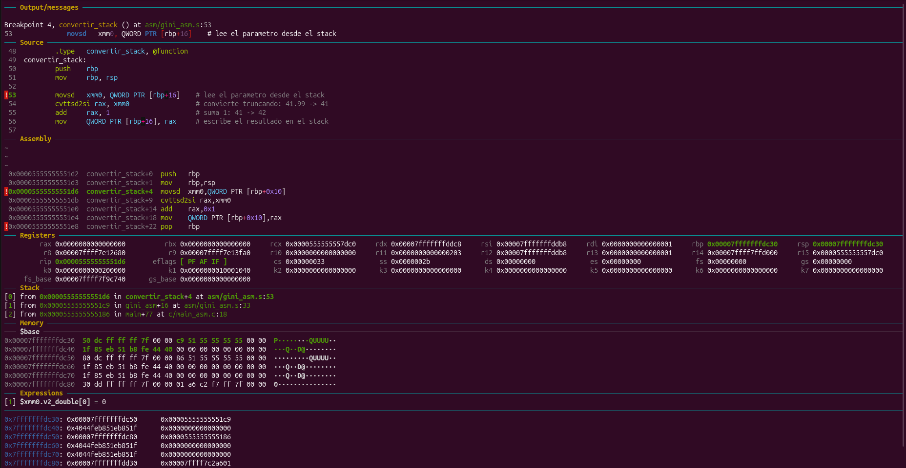
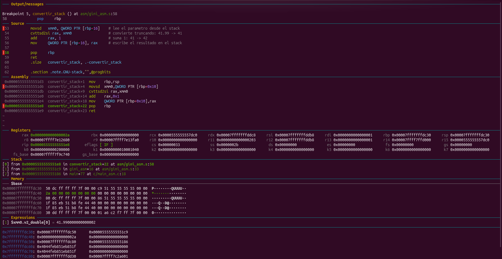
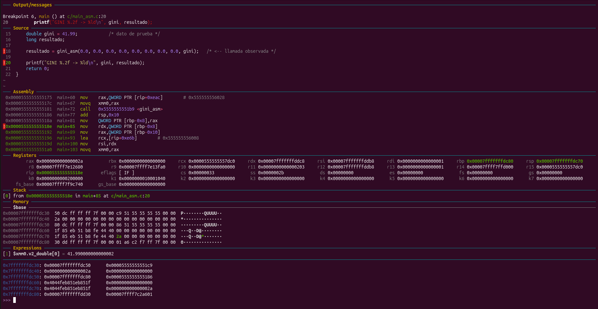
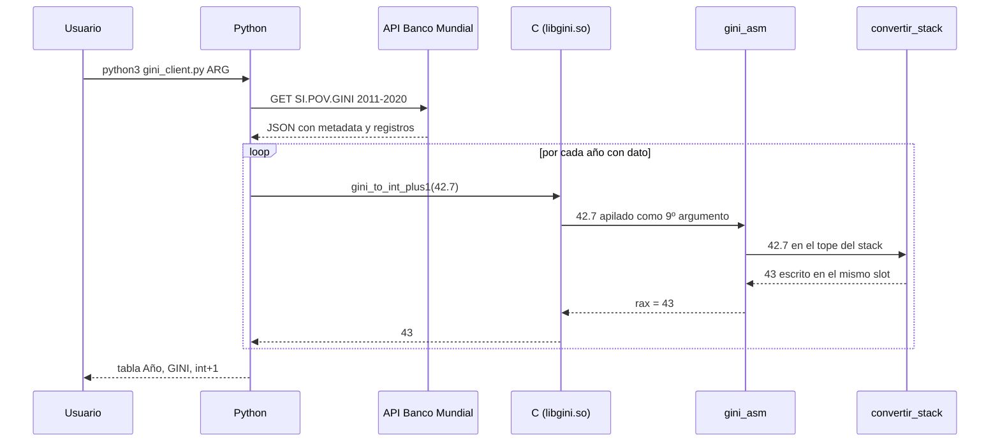

# TP2_StackFrame — Calculadora de índice GINI

Trabajo práctico de **Sistemas de Computación** (FCEFyN – UNC).

**Repositorio:** <https://github.com/valendipaolo/TP2_StackFrame>

El programa consulta el índice GINI de un país en la API REST del Banco Mundial, convierte cada valor de `double` a entero y le suma 1. Para eso atraviesa tres capas: Python, C y ensamblador x86-64. El objetivo central es mostrar cómo un lenguaje de alto nivel llama a uno de bajo nivel respetando la convención de llamadas **System V AMD64**. Los parámetros y resultados viajan por el **stack**, y su estado se inspecciona con GDB antes, durante y después de la llamada.

## Integrantes

| Nombre | Usuario de GitHub |
|---|---|
| Acuña Maria Pia | piaacu |
| Di Paolo Valentino | valendipaolo |

## Arquitectura



| Capa | Archivo | Responsabilidad |
|---|---|---|
| Superior | `python/gini_client.py` | Consulta la API, descarta los años sin dato, llama a la biblioteca de C con `ctypes` y muestra la tabla. |
| Intermedia | `c/gini.c` | Puente entre Python y el ensamblador. No hace la cuenta: llama a `gini_asm` pasando el valor por el stack. |
| Inferior | `asm/gini_asm.s` | Convierte el `double` a entero truncando (`cvttsd2si`) y suma 1. |

`c/main_asm.c` es un programa de C puro con un valor fijo (41.99). Llama directamente a `gini_asm` y se usa para la sesión de GDB, sin Python de por medio.

## Estructura del repositorio

```
.
├── python/gini_client.py   capa superior (API + presentación)
├── c/gini.c, c/gini.h      capa intermedia
├── c/main_asm.c            programa de C puro para depurar con GDB
├── asm/gini_asm.s          capa inferior (ensamblador, sintaxis Intel)
├── docs/gdb_stack.gdb      script de GDB: stack antes, durante y después
├── docs/gdb_salida.txt     salida de esa sesión
├── docs/dashboard.gdb      sesión interactiva con GDB Dashboard
├── docs/img/               capturas de esa sesión
├── tests/sample_arg.json   respuesta guardada de la API (pruebas sin red)
└── Makefile
```

## Requisitos

- Linux x86-64 (probado en Ubuntu)
- `gcc`, `make`, `gdb`: `sudo apt install build-essential gdb`
- Python 3 con `requests`: `sudo apt install python3-requests` o `pip install requests`

## Compilación y uso

```bash
make            # genera build/libgini.so y build/main_asm
make run        # consulta la API real (Argentina, 2011-2020)
make test       # usa tests/sample_arg.json, no necesita red
make gdb        # corre la sesión de depuración del stack
make clean
```

El cliente acepta otro país (código ISO3), otro rango de años o un JSON local:

```bash
python3 python/gini_client.py BRA --desde 2015 --hasta 2020
python3 python/gini_client.py --file tests/sample_arg.json
```

Salida con la API real:

```
Pais: Argentina
  Anio |   GINI | int+1 (asm)
----------------------------
  2011 |   42.7 |        43
  2012 |   41.4 |        42
  2013 |   41.1 |        42
  2014 |   41.8 |        42
  2016 |   42.3 |        43
  2017 |   41.4 |        42
  2018 |   41.7 |        42
  2019 |   43.3 |        44
  2020 |   42.7 |        43
```

## Iteraciones

El enunciado pide dos iteraciones. Cada una está marcada con un tag:

| Tag | Contenido |
|---|---|
| `iteracion-1` | Python + C. La conversión se hace en C, sin ensamblador. |
| `iteracion-2` | Python + C + ensamblador. El dato viaja por el stack y la sesión de GDB lo muestra. |

```bash
git checkout iteracion-1   # ver la primera versión
git checkout main          # volver
```

## Convención de llamadas: cómo viaja el dato por el stack

### System V AMD64

En Linux x86-64, la convención reparte los argumentos así:

| Tipo de argumento | Dónde viaja |
|---|---|
| Enteros y punteros, del 1º al 6º | `rdi`, `rsi`, `rdx`, `rcx`, `r8`, `r9` |
| Punto flotante, del 1º al 8º | `xmm0` … `xmm7` |
| Los que no entran en registros | Stack, apilados por quien llama |
| Valor de retorno entero | `rax` |

Una función con un único `double` lo recibiría en `xmm0` y nunca tocaría el stack. Para que el dato viaje por el stack *usando la convención* y no con un acuerdo propio entre rutinas, `gini_asm` declara 9 parámetros `double`. Los primeros 8 son relleno con valor 0.0 y ocupan `xmm0`–`xmm7`. El 9º, el índice GINI, ya no tiene registro disponible y el compilador de C lo apila. Es el mismo recurso que el ejemplo `suma_por_pila` de la cátedra, aplicado a registros de punto flotante.

```c
long gini_asm(double r0, double r1, double r2, double r3,
              double r4, double r5, double r6, double r7,
              double valor);                       /* valor -> stack */

return gini_asm(0.0, 0.0, 0.0, 0.0, 0.0, 0.0, 0.0, 0.0, valor);
```

El código que genera gcc antes y después del `call` (`disassemble main`; puede variar levemente según la versión del compilador):

```nasm
sub    rsp,0x8                    ; relleno: rsp queda múltiplo de 16 en el call
push   QWORD PTR [rbp-0x10]       ; 9º argumento: gini
pxor   xmm7,xmm7                  ; argumentos 1 a 8: 0.0 en xmm7 ... xmm0
...
call   gini_asm                   ; apila la dirección de retorno y salta
add    rsp,0x10                   ; caller-cleanup: saca relleno + argumento
mov    QWORD PTR [rbp-0x8],rax    ; resultado = rax
```

### Dentro del ensamblador

Después del prólogo (`push rbp` / `mov rbp, rsp`), toda función ve su frame igual:

| Posición | Contenido |
|---|---|
| `[rbp+16]` | Primer argumento pasado por stack |
| `[rbp+8]` | Dirección de retorno (la apiló `call`) |
| `[rbp]` | `rbp` de la función que llamó |

`gini_asm` lee el valor en `[rbp+16]` y se lo pasa a `convertir_stack` con el mismo patrón que usa gcc: relleno, `push` y `call`. `convertir_stack` hace la cuenta y **escribe el resultado en el mismo slot del stack** donde recibió el parámetro. `gini_asm` lo lee desde ahí y lo devuelve a C en `rax`, como indica la convención.

```nasm
gini_asm:
        push    rbp
        mov     rbp, rsp
        sub     rsp, 8                  ; relleno: alineación a 16
        push    QWORD PTR [rbp+16]      ; parámetro que apiló C -> tope del stack
        call    convertir_stack
        mov     rax, QWORD PTR [rsp]    ; resultado <- stack
        mov     rsp, rbp
        pop     rbp
        ret

convertir_stack:
        push    rbp
        mov     rbp, rsp
        movsd   xmm0, QWORD PTR [rbp+16]    ; lee el parámetro (41.99)
        cvttsd2si rax, xmm0                 ; trunca: 41
        add     rax, 1                      ; 42
        mov     QWORD PTR [rbp+16], rax     ; escribe el resultado en el stack
        pop     rbp
        ret
```

Dos reglas del ABI explican las instrucciones que no hacen "la cuenta":

- **Alineación.** `rsp` debe ser múltiplo de 16 justo antes de cada `call`. Apilar un solo argumento de 8 bytes la rompería, por eso se resta 8 de relleno antes del `push`.
- **Caller-cleanup.** Quien apila los argumentos es quien los saca. Por eso `main` hace `add rsp,0x10` después del `call`.

## Depuración con GDB: el stack antes, durante y después

```bash
make gdb                                  # muestra la sesión en pantalla
make gdb > docs/gdb_salida.txt            # la guarda
```

`docs/gdb_stack.gdb` pone un breakpoint en cada etapa e imprime los registros y la memoria del stack (`x/4gx`, `x/1fg`). La salida completa está en [`docs/gdb_salida.txt`](docs/gdb_salida.txt).

### Etapas

| Etapa | Punto de parada | `rsp` | `rbp` | Qué cambió |
|---|---|---|---|---|
| ANTES | `main_asm.c:18`, antes de la llamada | `0x7fffffffdbd0` | `0x7fffffffdbe0` | Frame de `main` con `gini` y `resultado`. Nada apilado aún. |
| DURANTE 1 | Primera instrucción de `gini_asm` | `0x7fffffffdbb8` | `0x7fffffffdbe0` | C apiló relleno y `gini`; `call` apiló la dirección de retorno. `xmm0` = 0. |
| DURANTE 2 | `gini_asm` tras el prólogo | `0x7fffffffdbb0` | `0x7fffffffdbb0` | Se guardó el `rbp` de `main`. `[rbp+16]` = 41.99. |
| DURANTE 3 | `convertir_stack` tras el prólogo | `0x7fffffffdb90` | `0x7fffffffdb90` | `gini_asm` re-apiló el parámetro; nuevo frame. |
| DURANTE 4 | `convertir_stack` antes de `pop rbp` | `0x7fffffffdb90` | `0x7fffffffdb90` | `[rbp+16]` pasó de 41.99 a 42. |
| DURANTE 5 | `gini_asm` tras leer el resultado | `0x7fffffffdba0` | `0x7fffffffdbb0` | `rax` = 42. |
| DURANTE 6 | `main`, justo después del `call` | `0x7fffffffdbc0` | `0x7fffffffdbe0` | El argumento sigue apilado; falta `add rsp,0x10`. |
| DESPUÉS | `main_asm.c:20` | `0x7fffffffdbd0` | `0x7fffffffdbe0` | `resultado` = 42. `rsp` volvió al valor de ANTES. |

### Mapa del stack en el punto más profundo (DURANTE 4)

Direcciones altas arriba; el stack crece hacia abajo.

| Dirección | Contenido | Significado | Frame |
|---|---|---|---|
| `0x7fffffffdbe8` | — | Dirección de retorno de `main` (a libc) | `main` |
| `0x7fffffffdbe0` | — | `rbp` guardado por `main` | `main` |
| `0x7fffffffdbd8` | sin inicializar | `resultado` | `main` |
| `0x7fffffffdbd0` | `0x4044feb851eb851f` | `gini` = 41.99 | `main` |
| `0x7fffffffdbc8` | relleno | Alineación (`sub rsp,0x8` en `main`) | argumentos |
| `0x7fffffffdbc0` | `0x4044feb851eb851f` | 9º argumento: copia de `gini` | argumentos |
| `0x7fffffffdbb8` | `0x0000555555555186` | Retorno a `main` (`main+77`) | `gini_asm` |
| `0x7fffffffdbb0` | `0x00007fffffffdbe0` | `rbp` de `main` | `gini_asm` |
| `0x7fffffffdba8` | relleno | Alineación (`sub rsp, 8` en `gini_asm`) | `gini_asm` |
| `0x7fffffffdba0` | `0x000000000000002a` | Parámetro, ahora resultado = 42 | `gini_asm` |
| `0x7fffffffdb98` | `0x00005555555551c9` | Retorno a `gini_asm` | `convertir_stack` |
| `0x7fffffffdb90` | `0x00007fffffffdbb0` | `rbp` de `gini_asm` | `convertir_stack` |

### La prueba de que el dato llegó por el stack

Al entrar a `gini_asm`, el valor está en `[rsp+8]` y `xmm0` vale 0:

```
================ DURANTE 1 (entrada a gini_asm) ================
C hizo: sub rsp,8 / push gini / call  ->  rsp bajo 24 bytes
rsp            0x7fffffffdbb8      0x7fffffffdbb8
--- [rsp]=dir. retorno a main  [rsp+8]=GINI APILADO POR C  [rsp+16]=relleno ---
0x7fffffffdbb8:	0x0000555555555186	0x4044feb851eb851f
0x7fffffffdbc8:	0x0000000000000000
0x7fffffffdbc0:	41.990000000000002
--- xmm0 es relleno: el dato NO vino por registro ---
$1 = 0
```

`0x4044feb851eb851f` es la representación IEEE 754 de 41.99. `x/gx` muestra los bits crudos y `x/fg` los interpreta como `double`. El valor aparece como 41.990000000000002 porque 41.99 no tiene representación binaria exacta.

Al terminar, `rsp` vale lo mismo que en ANTES (`0x7fffffffdbd0`). Cada `push` y `call` tuvo su `pop`, `ret` o `add rsp` correspondiente, y el stack quedó balanceado.

### Con GDB Dashboard

Para seguir el stack de forma visual (requiere [gdb-dashboard](https://github.com/cyrus-and/gdb-dashboard) en `~/.gdbinit`):

```bash
gdb -q -x docs/dashboard.gdb build/main_asm
```

El script `docs/dashboard.gdb` configura los paneles (source, assembly, registers, stack, memory y `xmm0` en expressions), pone un breakpoint en cada etapa, corre el programa y queda parado en ANTES. La zona de memoria observada queda fija en `$base = $rsp - 0x40` (96 bytes), que cubre desde el frame de `main` hasta el de `convertir_stack`. El comando `paso`, definido en el script, avanza a la etapa siguiente y vuelve a imprimir esa zona con `x/12gx`.

Las direcciones de esta sesión están desplazadas `0xa0` respecto de las tablas anteriores (por ejemplo, `rsp` en ANTES vale `0x7fffffffdc70` en lugar de `0x7fffffffdbd0`) porque GDB interactivo le pasa otro entorno al programa. Las posiciones relativas a `rsp` y `rbp` son idénticas. El panel Memory resalta en verde los bytes que cambiaron desde la parada anterior.

**ANTES**: frame de `main`, con `gini` = 41.99 en `[rsp]`. Todavía no se apiló nada. `xmm0` tiene 41.99 como resto de la inicialización de `gini`; los `pxor` que siguen lo ponen en 0.


**DURANTE 1**: entrada a `gini_asm`. Retorno a `main` en `[rsp]`, 41.99 en `[rsp+8]` (lo apiló C) y `xmm0` = 0: el dato no llegó por registro.


**DURANTE 2**: prólogo de `gini_asm`. `rbp` = `rsp` y el `rbp` de `main` guardado en `[rbp]`.


**DURANTE 3**: frame de `convertir_stack`. Retorno a `gini_asm` en `[rbp+8]`, parámetro en `[rbp+16]` y tres frames en el panel Stack.


**DURANTE 4**: el slot del parámetro pasó de 41.99 a 42 (`0x2a`) y `rax` = 42. `xmm0` vuelve a valer 41.99 porque `convertir_stack` lo cargó desde el stack para convertirlo.


**DESPUÉS**: `rsp` volvió a `0x7fffffffdc70` y `resultado` = 42. Debajo de `rsp` siguen los valores viejos: retornar no borra la memoria, solo mueve `rsp`.


## Diagrama de secuencia



## Decisiones de diseño

**Truncamiento y no redondeo.** `cvttsd2si` trunca hacia cero (41.99 → 41 → 42). `cvtsd2si` redondea según el modo de MXCSR, por defecto al más cercano (41.99 → 42 → 43). Se eligió truncar porque coincide con el cast `(long)valor` de C usado en la iteración 1, y así ambas iteraciones dan el mismo resultado.

**Retorno en `rax`.** La frontera C ↔ asm respeta el ABI: el valor de retorno entero vuelve en `rax`. El retorno por stack se muestra en la llamada interna `gini_asm → convertir_stack`.

**Años sin dato.** La API devuelve `null` para algunos años; para Argentina, 2015. El cliente los descarta antes de llamar a C.

## Referencias

- Paul A. Carter, *Lenguaje Ensamblador para PC* — <http://pacman128.github.io/pcasm/>
- System V AMD64 ABI — <https://gitlab.com/x86-psABIs/x86-64-ABI>
- Eli Bendersky, *Stack frame layout on x86-64* — <https://eli.thegreenplace.net/2011/09/06/stack-frame-layout-on-x86-64>
- API del Banco Mundial, indicador SI.POV.GINI — <https://api.worldbank.org/v2/country/ARG/indicator/SI.POV.GINI?format=json>
- gdb-dashboard — <https://github.com/cyrus-and/gdb-dashboard>
